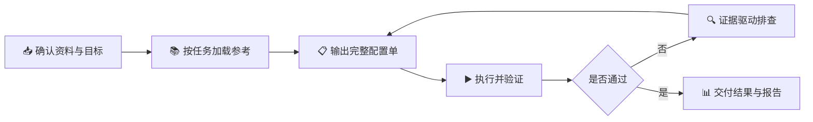

# 🧪 接口测试与基础压测工作流

> 把零散的接口资料，整理成 **可检查、可重复、可交付** 的测试配置。

面向 HTTP API 的完整工作流：**单接口调试 → 自动化场景 → 基础压测 → 证据化排查**。默认围绕 **Apifox** 展开，只有明确需要时才提供 **JMeter** 迁移方案。


---

## ✨ 它能做什么

| 场景 | 交付内容 |
| --- | --- |
| 🔌 单接口调试 | 方法、最终 URL、参数、鉴权、成功判定，一次列全 |
| 🌐 环境与认证 | 域名拆分、环境变量、Token 获取/刷新/持久化 |
| 🧩 自动化场景 | 步骤顺序、引用与同步、变量作用域、失败分支 |
| 🚀 基础压测 | 负载模型、采样与断言、验收口径、结果报告 |
| 🔍 故障排查 | 证据表、判断边界、下一项最小验证 |
| 🔁 JMeter 迁移 | 组件映射对照、变量与脚本迁移、可运行计划 |

---

## 🔄 工作流程



1. **确认资料与目标** — 工具、环境、接口范围、写操作授权与成功标准。
2. **按任务加载参考** — 只读当前相关的那一份，不扩大范围。
3. **输出完整配置单** — 域名、变量、请求、前后置、脚本与执行顺序。
4. **执行并验证** — 最小必要请求，逐层确认实际解析结果。
5. **证据驱动排查** — 观察 → 结论 → 假设 → 下一项验证。
6. **交付** — 修改清单、差异、导入方式与仍需人工完成的步骤。

---

## 📂 目录结构

```text
api-test-performance-workflow/
├── SKILL.md                          # 主流程：确认 → 配置 → 验证 → 交付
├── agents/
│   └── openai.yaml                   # 触发器：名称、简介与默认提示词
├── references/
│   ├── apifox-setup.md               # Apifox 环境 / 认证 / 脚本 / 场景模板
│   ├── diagnostics-performance.md    # 失败排查与压测验收报告
│   └── jmeter-migration.md           # JMeter 条件迁移对照
└── README.md
```

---

## 🚀 快速开始

把仓库放进所用 Agent 的 `skills` 目录（保持目录名 `api-test-performance-workflow`），或直接让 Agent 读取 `SKILL.md`，然后按目标提问：

```text
💬 使用 api-test-performance-workflow，帮我梳理这份 Apifox 导出：
   补齐环境、域名、Token 与断言，给出完整配置和执行顺序。

💬 压测结果全是 0，按证据排查流程定位原因。

💬 把这个 Apifox 场景迁移到 JMeter，给出完整对照和 JMX 结构。
```

---

## 🧭 核心原则

- **证据优先** — 先看实际请求、响应和日志，再谈结论。
- **一次说清** — 配置、作用域、顺序集中交付，避免反复返工。
- **验收分层** — 结构校验 ≠ 实际发送 ≠ 功能通过 ≠ 压测达标。
- **边界清晰** — 不编造参数和凭据，真实值不写进通用模板。

---

## 📚 深入阅读

- 🛠️ [Apifox 完整配置与交付模板](references/apifox-setup.md)
- 🩺 [证据排查与基础压测](references/diagnostics-performance.md)
- 🔁 [JMeter 条件迁移指南](references/jmeter-migration.md)

---

## ⚠️ 适用边界

- 只覆盖 HTTP API；不替代服务端监控、容量规划与安全测试。
- 菜单、开关和能力随工具版本变化，以当前界面与官方文档为准。
- 文档中的变量名、路径均为示例槽位，需替换为真实接口值。

> 以实际请求与响应为准 —— 没有证据，就不下结论。
